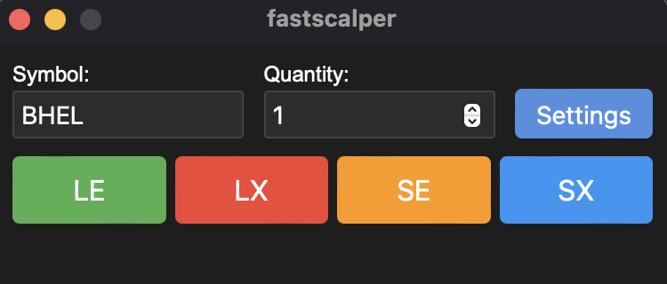

# FastScalper

FastScalper is a compact desktop order pad for scalping through your own [OpenAlgo](https://github.com/marketcalls/openalgo) server. It is one small window with a symbol, a quantity and four buttons, so an entry or an exit is always one click away.



## Download

Get the installer for your system from the [latest release](https://github.com/marketcalls/fastscalper-tauri/releases/latest). The release notes explain which file to pick and how to open an unsigned build the first time.

| System | File to download |
| --- | --- |
| Windows 10 and 11 (x64) | `FastScalper_<version>_x64-setup.exe` (or the `.msi` for managed installs) |
| macOS with Apple Silicon | `FastScalper_<version>_aarch64.dmg` |
| macOS with an Intel processor | `FastScalper_<version>_x64.dmg` |
| Ubuntu, Debian, Linux Mint | `FastScalper_<version>_amd64.deb` (or `arm64.deb`) |
| Fedora, RHEL, openSUSE | `FastScalper-<version>-1.x86_64.rpm` (or `aarch64.rpm`) |
| Any other Linux | `FastScalper_<version>_amd64.AppImage` (or `aarch64.AppImage`) |

## Using FastScalper

1. Start OpenAlgo and copy your API key from its dashboard.
2. Open FastScalper. Settings opens on first launch: enter the API key and the host URL (default `http://127.0.0.1:5000`), click **Test** next to the host URL to check the connection, then **Save**.
3. Type a symbol and a quantity, then use the buttons.

| Button | Meaning | Order sent to OpenAlgo |
| --- | --- | --- |
| LE | Long entry | BUY, your quantity |
| LX | Long exit | SELL, quantity 0 (OpenAlgo closes the open position) |
| SE | Short entry | SELL, your quantity |
| SX | Short exit | BUY, quantity 0 (OpenAlgo closes the open position) |

Every order is a MARKET smart order (`/api/v1/placesmartorder`) tagged with the strategy name `FastScalper`. The line under the buttons shows the order id or the server message.

Safety behaviour worth knowing:

- Clicking the same button again while its order is in flight does nothing, but an exit is never held back by a pending entry.
- If the network fails mid-order, FastScalper never retries. The order may still have reached your broker, so check the order book first.
- No keyboard shortcut places an order.

### Settings

| Setting | Default | Notes |
| --- | --- | --- |
| API key | empty | Required before any order is sent. |
| Host URL | `http://127.0.0.1:5000` | Where OpenAlgo runs. |
| Exchange | NSE | NSE, NFO, CDS, BSE, BFO, BCD, MCX, NCDEX |
| Product | MIS | CNC, NRML, MIS |
| Voice alerts | off | Speaks "Buy Order", "Buy Exit", "Short Order" or "Short Exit". |
| Always on top | off | Keeps the pad above your charts. |

Settings are saved in `settings.json` in the app config folder, which you can also edit by hand while the app is closed:

| System | Location |
| --- | --- |
| Windows | `%APPDATA%\com.fastscalper.app\settings.json` |
| macOS | `~/Library/Application Support/com.fastscalper.app/settings.json` |
| Linux | `~/.config/com.fastscalper.app/settings.json` |

Upgrading from 0.1.0: FastScalper imports your old settings on first launch when it can find them. If Settings opens empty, enter them once.

## Development

### Prerequisites

- Node.js 24 (see `.nvmrc`; 22.22.2 or later also works)
- Rust through [rustup](https://rustup.rs). The exact toolchain (1.99.1) is pinned in `rust-toolchain.toml` and installs itself on first build.
- The Tauri system dependencies for your OS: [Tauri 2 prerequisites](https://v2.tauri.app/start/prerequisites/)

### Common commands

```bash
npm install            # install frontend dependencies
npm run tauri dev      # run the app with live reload
npm run tauri build    # build installers into src-tauri/target/release/bundle
```

| Check | Frontend (repo root) | Backend (`src-tauri`) |
| --- | --- | --- |
| Lint | `npm run lint` | `cargo clippy --all-targets -- -D warnings` |
| Format | `npm run format:check` | `cargo fmt --check` |
| Types | `npm run typecheck` | (compiler) |
| Tests | `npm test` or `npm run test:coverage` | `cargo test` |

No test talks to a real OpenAlgo server or broker. Frontend tests fake the Tauri IPC layer; backend tests run against a local mock HTTP server and Tauri's mock runtime.

### How it fits together

```
React UI (src/)  --invoke-->  Tauri commands (src-tauri/src/commands.rs)
                                   |
                                   v
                              OpenAlgo client (src-tauri/src/openalgo/)  --HTTP-->  OpenAlgo server
```

The webview never makes network calls itself. It calls two commands, `place_order` and `test_connection`; the Rust side validates input, sends the request and returns either a result or a typed error (`validation`, `network`, `api` or `decode`). The contract is defined once on each side: `src/api/types.ts` and `src-tauri/src/openalgo/models.rs`.

```
src/
  api/          typed wrappers for the Tauri commands
  components/   OrderPad, StatusBar, SettingsDialog and small building blocks
  settings/     settings type, defaults, validation, versioned storage
  trading/      button-to-order mapping, order placement hook
  feedback/     status messages and error descriptions
  lib/          speech, window size and always-on-top helpers
  styles/       design tokens and global styles
src-tauri/
  src/          commands, error type, OpenAlgo client and reply parsing
  tests/        IPC tests through Tauri's mock runtime
  capabilities/ permissions granted to the window
```

## Continuous integration and releases

Every pull request and push to `master` runs lint, format, type, test and build checks for the frontend, and fmt, clippy and tests for the backend on Linux, Windows and macOS (`.github/workflows/ci.yml`).

Pushing a version tag such as `v0.1.1` builds installers for every platform above and publishes a GitHub release (`.github/workflows/release.yml`). See [docs/RELEASING.md](docs/RELEASING.md) for the full checklist and for adding code signing later.

## Contributing

Fork the repository, create a branch, make sure the checks above pass, and open a pull request.

## License

[MIT](LICENSE)
